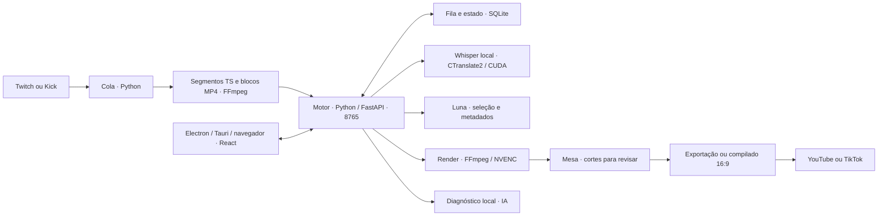

# Clipador — estado operacional e plano para a estreia do GTA VI

**Verificação local em 16/11/2026, às 15h34 de Brasília.** Revisão do Antigravity Gemini 4 Hydrogen em xhigh integrada pelo Codex. Executável Tauri empacotado, compilado e validado sem Vite: origem real `http://tauri.localhost`, sessão 200, React montado e quadro de vídeo de 1080 px silenciado. A Mesa foi inspecionada visualmente com 105 cortes e ficou aberta. Cliente de contas, typecheck e build do frontend passaram. A suíte completa do motor segue com o delegado de CORS: uma falha registrada, sem contagem final confirmada. Histórico e limites nas [specs](README.md), [auditoria](../90-Auditorias/rev-code-review.md) e [quadro](Quadro-da-Estreia.md). Sem push.

## Situação agora

**O motor local responde e os cortes existentes estão disponíveis pela API. A fonte da estreia ficou só com o garimpeiro da Twitch. Ela ainda depende de reiniciar a Cola e ensaiar o fluxo do clipe até a Mesa.** Os canais de postagem também precisam ser conectados e verificados. A exportação local de MP4 já oferece um caminho para publicar manualmente.

| Componente | Estado observado | Efeito imediato |
| --- | --- | --- |
| Motor `127.0.0.1:8765` | **Ativo.** `python.exe`, Python 3.11.15, FastAPI e Uvicorn. Instância iniciada às 03h38. | Fila e Mesa respondem. A instância carrega a análise visual em lotes quando for reiniciada. |
| Fila | **Livre.** Zero processando, zero esperando, cinco vagas de processamento e pausa desligada. | Há espaço na fila para ensaiar uma origem. O estado em repouso ainda precisa ser comparado com a carga de captura contínua. |
| Cola e gravador | **Configuração nova, processo antigo.** Por escolha do usuário em 16/11, `config.toml` ficou só com o garimpeiro: clipes da Twitch de GTA V e GTA VI das últimas 2 h, com 50+ visualizações. O gravador não tem canais fixos. O processo em execução (desde 15/11 02h05) ainda usa a configuração anterior, só com BaianoTV no LoL, e o `cola.log` está sem eventos desde 15/11 às 23h05. Os últimos `.ts` são de 14/11. | Nada entra até a Cola ser reiniciada. Para isso, feche a janela "Cola" e rode `iniciar.cmd cola`. Depois, nenhuma live é gravada inteira: só os clipes que a Twitch já tem. |
| Mesa e compilados | **Disponíveis pela API.** 105 cortes pendentes, zero aprovados e 105 fontes disponíveis para compilação. | Dá para revisar o acervo e ensaiar exportação. O número é histórico da Mesa, separado da fila de novos blocos. |
| Janela Tauri e frontend `5173` | **Executável empacotado validado.** Assets em `http://tauri.localhost`, sem Vite; sessão 200 e prévia de 1080 px no mudo. Mesa com 105 cortes inspecionada por captura e acessibilidade. Ponte de contas conectadas corrigida e testada. | Abrir `cache/tauri-target/release/clipador-tauri.exe`; janela deixada aberta na Mesa. Caches e perfil no D:. Instalador separado e desativado por padrão. Importação nativa, OAuth e ensaio completo seguem pendentes. |
| Luna e Whisper | **ChatGPT conectado**, com `gpt-6-luna` selecionado e Whisper local. A autorização para automação do plano está desligada. O assistente interno da interface informa indisponibilidade. | A análise de cortes pelo Luna já respondeu em teste. O caminho agendado, a ingestão pela Cola e o assistente interno têm verificações distintas. |
| YouTube e TikTok | **Desconectados.** YouTube direto sem cliente OAuth configurado. Composio configurado, sem conexão ativa de YouTube ou TikTok. | Postagem automática está bloqueada. Dá para preparar MP4 e texto para postagem manual. |
| Disco D | **107,5 GiB livres** na consulta. A Cola tem guarda de gravação em **20 GiB livres**. | O espaço inicial comporta o ensaio. Blocos retidos, temporários e logs podem consumir a margem durante uma pane. |
| Diagnóstico | **Respondendo.** Histórico com três falhas de processamento. Logs do motor e do gravador disponíveis pela sessão local. | As falhas históricas já identificadas eram de login do ChatGPT. O estado atual do login foi verificado em consulta própria. |
| Permissões do Windows | **P0 aberto, comandos prontos.** `D:\clipador-gta6` herda do D: `Usuários autenticados` com Modify e `Usuários` com leitura, inclusive em `session.secret` e `cola\.env`. O `andre` é o dono e só tem acesso por esses grupos. As entradas do Codex (`CodexSandboxUsers` e dois SIDs) são explícitas. | Qualquer conta da máquina lê ou altera segredos, banco e código. Correção, como `andre`, sem administrador: `icacls "D:\clipador-gta6" /grant "andre:(OI)(CI)F"`, depois `icacls "D:\clipador-gta6" /inheritance:d` e por fim `icacls "D:\clipador-gta6" /remove:g *S-1-5-11 *S-1-5-32-545`. As entradas do Codex continuam. |
| Código e cofre no git | **Commitado em 16/11, sem push.** O checkout `clips-kitty` serve o app no branch `codex-estreia`, criado a partir de `2076713`. O código do Codex está em `141a687`: Tauri, compilados, Composio, diagnóstico, marca Cortes Gamer, análise em lotes e i18n. O commit seguinte guarda este cofre. A Cola está em `codex-estreia` `dc23621`, com blocos de 4 + 1 min, a chave `habilitado` e `abrir-tauri.cmd`. Ficaram fora: o `config/settings.yaml` local, além de `main.js`, `styles.css` e `workspace.json` dos plugins do Obsidian. O fork ainda tem 9 commits do `gta6-melhorias` sem push. | O trabalho sobrevive a `checkout` e `stash`. O `wt-fork` continua no `gta6-melhorias`, sem esse trabalho, até um merge. |
| Agentes (Codex e Antigravity) | **Revisão Hydrogen xhigh concluída**, com cinco grupos de ajustes integrados pelo Codex principal. O delegado anterior do Tauri foi cancelado para impedir edições concorrentes. O delegado de CORS mantém a suíte completa do motor. | T3 aberto pela raiz; cartão Tauri marcado `#codex`. Antigravity revisa sem editar, Codex implementa e registra evidências no cofre. |
| Testes do código atual | **Tauri e frontend validados nesta rodada:** cliente de contas, typecheck, build React, build Tauri e ensaio real sem Vite. O histórico anterior registra 215 testes selecionados do motor e 70 da Cola. | A suíte completa do motor continua em execução e já registrou uma falha; a causa e a contagem final dependem do encerramento. O ensaio ponta a ponta da captura e postagem permanece pendente. |

A Rockstar anuncia o jogo para a meia-noite local de **19/11/2026** em PS5 e Xbox Series X|S. Na Nova Zelândia continental isso corresponde a **18/11/2026, às 8h de Brasília**. O início da captura depende da primeira transmissão autorizada entrar no ar. [Rockstar Games](https://support.rockstargames.com/articles/29jV3Cv2cCgvwM1XgtMO5o/grand-theft-auto-vi-regional-pre-load-and-release-times-on-playstation-5-and-xbox-series-x-or-s) · [Horário de verão da Nova Zelândia](https://www.govt.nz/browse/recreation-and-the-environment/daylight-saving/)

## Como as partes se conectam

O motor é o serviço na porta `8765`. O Tauri usa Rust e WebView2 para exibir o React. Em desenvolvimento, o React é servido pelo Vite na `5173`. A Cola é outro processo Python. Ela observa lives, grava com FFmpeg e entrega blocos ao motor. Assim, uma falha no frontend impede revisar pela janela, enquanto captura e fila dependem dos respectivos processos e do disco. [Arquitetura e portas](README.md) · [Protótipo Tauri](../../../../ui/src-tauri/README.md)

## Estado por módulo e critério da próxima entrega

**Ativo** significa observado no serviço em execução. **Validado** significa que um ensaio confirmou o comportamento indicado. **Implementado** significa que o código existe e pode depender de reinício, configuração ou teste de ponta a ponta. **Pendente** identifica a próxima entrega da spec.

### 01. Desktop, API local e credenciais

- **Feito.** Electron e modo web já foram usados no Windows. A janela Tauri em Rust abriu o React, consultou a Mesa e decodificou uma prévia no mudo com largura de 1080 pixels. A verificação pelo WebView2 retornou código `0`. A captura automatizada de tela expirou e o WebView2 registrou `1412` no encerramento de teste.
- **Agora.** Executável empacotado compilado e inspecionado sem Vite. O ensaio confirmou origem real, API, sessão 200, React e vídeo de 1080 px no mudo. A Mesa exibe 105 cortes; nenhum foi aprovado, descartado ou publicado. Cliente de contas, typecheck e build do frontend passaram.
- **Falta.** Seleção nativa de arquivos/pastas, exportação, abertura de OAuth no navegador e instalador. R01 e a autenticação das demais rotas sensíveis continuam como cartões próprios. Ensaio completo de importar, gerar, revisar, exportar e recuperar após reinício ainda pendente.
- **Aceite.** Importar mídia, gerar corte, revisar, exportar e reencontrar a Mesa após reiniciar a janela e o motor. Medir Tauri e Electron com a mesma tela, mídia e estado de fila. [Spec 01](../01-Arquitetura/01-desktop-e-api.md)

### 02. Descoberta de lives e chat

- **Feito.** A Cola consulta Twitch Helix e verifica canais Kick por categoria. A categoria GTA VI já foi encontrada na Twitch em consulta anterior. O repositório também tem componentes opcionais de eventos Twitch e deduplicação.
- **Agora.** Desde 16/11 a configuração usa só o garimpeiro: clipes da Twitch de GTA V e VI, sem canais fixos no gravador. A mudança vale quando a Cola reiniciar. A lista de candidatos de GTA VI no Controle e os sinais de chat ao vivo ainda são etapas de implementação.
- **Falta.** Escolher uma fonte autorizada de GTA VI. Depois incluir descoberta por categoria, atualização do cache, paginação, estado desconhecido e tempo de retomada em `429`. Testar cada plataforma isoladamente.
- **Aceite.** Uma live configurada é reconhecida e a gravação começa. Um provedor lento ou temporariamente indisponível preserva gravações em andamento e permite consultar os demais. [Spec 02](../02-Captura-e-fila/02-descoberta-de-lives.md)

### 03. Gravação, blocos e entrega ao motor

- **Feito.** FFmpeg gera segmentos. A Cola concatena e envia blocos com sobreposição. Com fila cheia ou conexão indisponível, os blocos esperam em disco. Recusas explícitas de mídia têm tratamento para preservar o arquivo rejeitado.
- **Agora.** São quatro minutos novos mais um minuto de sobreposição. O primeiro bloco precisa acumular cerca de cinco minutos de mídia em segmentos completos. A entrega ainda soma o intervalo de verificação e o tempo da fila. O processo atual da Cola é anterior ao novo aviso que distingue erro de consulta à Kick de canal fora do ar.
- **Falta.** Separar a supervisão da gravação do envio e da concatenação. Identificar cada bloco pelo canal e intervalo, guardar confirmação durável e manter o arquivo quando a resposta do motor for inconclusiva.
- **Aceite.** Após fila cheia, queda do motor ou perda da resposta, o mesmo bloco volta a aparecer associado a uma única tarefa. Confirmar a integridade da captura e o próximo segmento após a falha. [Spec 03](../02-Captura-e-fila/03-gravacao-e-entrega.md)

### 04. Fila, admissão e armazenamento

- **Feito.** O motor usa SQLite, fila persistente, controle de pausa e recuperação de tarefas interrompidas. A interface informa cinco vagas de processamento.
- **Agora.** O limite de cinco cobre tarefas de processamento de fontes. Trabalhos como compilados disputam o mesmo trabalhador. Na importação de arquivo, parte do custo de sondagem e cópia é paga antes da verificação de capacidade.
- **Falta.** Reservar vaga e bytes antes da importação, deduplicar em transação e definir orçamento por tipo. Separar o espaço para segmentos, blocos pendentes, temporários e exportações.
- **Aceite.** Uma fila cheia recusa cedo e preserva o disco. Pedidos simultâneos para o mesmo bloco retornam a mesma tarefa. A ingestão de captura continua com compilado ou tradução aguardando. [Spec 04](../02-Captura-e-fila/04-fila-e-armazenamento.md)

### 05. Whisper, Luna e análise de cortes

- **Feito.** Whisper foi ensaiado offline com português e GPU. O Luna respondeu em teste pelo plano ChatGPT. A leitura em lotes da análise visual está implementada e passou em testes.
- **Medido.** No vídeo sintético de 20 minutos e em duas execuções por versão, o pico mediano do processo Python da análise visual caiu de **333 para 38 MiB**, e o tempo mediano de **3,48 para 1,61 s**. As saídas de movimento, cortes e brilho foram idênticas.
- **Agora.** O motor ativo foi iniciado antes da alteração. Ele incorpora a otimização no próximo reinício. A sessão do ChatGPT está ativa, e a autorização de automação do plano encontra-se desligada. É preciso ensaiar a origem da Cola e a origem agendada separadamente.
- **Feito em 16/11 (R09).** Na Cola, falha por login, limite do plano, crédito ou chave da IA volta a cada 30 min sem gastar as três tentativas, e o vídeo de origem fica no motor. O motor guarda só a mensagem do erro, então a Cola reconhece o tipo pelo texto.
- **Falta.** Usar o horário de retomada que o ChatGPT informa no lugar dos 30 min fixos. Distinguir timeout e falha definitiva. Retomar da transcrição quando houver. Medir Whisper frio, cache, análise e render em uma amostra de cinco minutos na máquina. Usar esses dados para selecionar uma eventual rotina Rust.
- **Aceite.** Ao simular limite de IA, o arquivo e a transcrição ficam disponíveis, o estado indica a causa e a próxima tentativa segue a janela do provedor. A saída da otimização mantém equivalência. [Spec 05](../03-Producao-de-clips/05-ia-e-transcricao.md)

### 06. Editor, legendas, marca e renderização

- **Feito.** O editor tem prévia no mudo, ajustes de legenda e a opção da marca **Cortes Gamer** com `@CortesGameroffc`. A marca oferece tamanho, opacidade e movimento na área efetiva do vídeo.
- **Critério editorial.** Legenda centralizada na área segura, tamanho moderado e **no máximo duas linhas**. Preservar o enquadramento e evitar cobrir a ação. O render final conserva a faixa de áudio e as opções que o editor revisou.
- **Falta.** Repetir o ensaio com cenas reais de GTA VI, layouts distintos, fala rápida e palavras longas. Medir peso do render NVENC com marca e legenda ligados, incluir teste de cancelamento e queda com temporários.
- **Aceite.** Uma amostra em cada formato mantém a legenda legível, a marca configurada e áudio sincronizado. Uma falha de render preserva a mídia anterior e deixa uma causa consultável. [Spec 06](../03-Producao-de-clips/06-editor-e-render.md)

### 07. Mesa e Controle

- **Feito.** A Mesa lista os cortes pendentes, permite revisar, editar metadados, aprovar ou descartar e copiar o texto da postagem. O Controle exibe dados da operação e das gravações.
- **Agora.** Os 105 cortes são servidos pela API. Para reabrir a interface do protótipo, o Vite precisa estar ativo.
- **Falta.** Fazer a entrega do MP4 e dos metadados com estado recuperável. Melhorar o caso de vídeo aberto em outra janela, concorrência durante aprovação, filtros e listagem com muitos cortes.
- **Aceite.** Um corte só entra na revisão depois da entrega completa. Se o PC, a API ou o disco falhar entre vídeo e metadados, a Mesa consegue reconciliar o mesmo item. O Controle mostra idade do último segmento e do último bloco. [Spec 07](../04-Mesa-e-publicacao/07-mesa-e-controle.md)

### 08. Compilado para vídeo longo no YouTube

- **Feito.** A interface permite escolher fontes da Mesa e da biblioteca e ordenar cortes. O motor exporta MP4 horizontal. O teste com duas fontes de proporções diferentes validou ordem, resolução 1920 × 1080, 30 fps e trilha de áudio.
- **Agora.** A API lista 105 fontes. A exportação local já foi ensaiada. O envio do compilado à conta do usuário depende da conexão e do ensaio de postagem.
- **Falta.** Estimar duração e espaço antes do render, limitar uso de temporários e agendar compilados sem competir com a primeira leva de clipes.
- **Aceite.** A saída conserva a ordem, a faixa de áudio e uma única marca por trecho. Compilado longo aguarda capacidade quando a captura estiver pressionada. [Spec 08](../04-Mesa-e-publicacao/08-compilados-youtube.md)

### 09. Contas e publicação

- **Feito.** Há rotas para YouTube direto e Composio. O fluxo Composio existente envia YouTube como privado e TikTok para a caixa de entrada. O trabalhador recupera uploads interrompidos sem reenviá-los automaticamente.
- **Agora.** YouTube direto, YouTube Composio e TikTok Composio estão desconectados. Os seis testes do painel voltaram a rodar no Node 25 em 16/11 (R17).
- **Falta.** Autorizar as contas escolhidas e verificar Shorts, vídeo longo e caixa do TikTok. Persistir o ID remoto do TikTok e distinguir entrega aceita, publicação confirmada e resultado incerto.
- **Aceite.** Conferir conta, visibilidade e ID de um ensaio privado ou de caixa. Simular timeout depois do envio e verificar que o resultado fica pendente de reconciliação antes de uma nova tentativa. [Spec 09](../04-Mesa-e-publicacao/09-publicacao-e-contas.md)

### 10. Diagnóstico, operação e ensaio

- **Feito.** A API local tem histórico estruturado de falhas e consulta limitada de logs do motor, da Cola e da tarefa. Usa sessão local e filtra URLs e campos de credenciais na resposta. A verificação Tauri também dá resultado no terminal com `--verificar`.
- **Agora.** As rotas respondem. O histórico disponível mostrou três falhas antigas de processamento. O log do motor pela API contém o trecho em memória.
- **Falta.** Propagar um identificador de bloco da captura até a postagem, persistir eventos com rotação e incluir eventos anteriores à criação da tarefa, interrupções e resultados de envio incertos. Distinguir janela, frontend, motor, gravação e provedor nos sinais do Controle.
- **Aceite.** Dado um bloco atrasado, o operador ou Codex encontra etapa, tempo, erro, próximo passo e último arquivo confirmado. Se o motor estiver parado, o operador consegue consultar os logs locais do supervisor e da Cola. [Spec 10](../05-Operacao/10-observabilidade-e-operacao.md)

### 11. Integrações, plugins e render remoto

- **Feito.** O projeto tem recursos para OBS, Connected Accounts, plugins e render remoto. A ideia do API Anything foi aproveitada no desenho da API estruturada de diagnóstico.
- **Agora.** O fluxo da estreia pode usar a API local e os serviços que já existem. As integrações opcionais têm credenciais, permissões e ensaios independentes.
- **Falta.** Inventariar as integrações realmente ligadas para a operação. Validar isolamento, revogação e fallback antes de incorporar plugins, outro renderizador ou adaptador web.
- **Aceite.** Uma extensão indisponível deixa a captura local, a fila e a exportação utilizáveis. [Spec 11](../06-Integracoes/11-integracoes-e-extensoes.md)

## Tratamento de erros e impacto quando as lives começarem

**P0** indica risco de perder a gravação, bloquear o ingresso ou comprometer dados e credenciais. **P1** indica atraso, retrabalho ou perda de visibilidade com um caminho de operação manual. A classificação operacional aqui complementa a severidade técnica da [revisão de código](../90-Auditorias/rev-code-review.md).

| Prioridade e cenário | O que acontece hoje | Prejuízo possível | Tratamento ou ação no ensaio |
| --- | --- | --- | --- |
| **P0 · Origem só pelo garimpeiro** | Desde 16/11 a configuração tem só o garimpeiro da Twitch, com GTA V e VI, janela de 2 h e 50+ visualizações. O gravador não tem canais. O processo da Cola em execução ainda é anterior a essa mudança. | Antes do lançamento a categoria GTA VI tem poucos clipes. Sem reiniciar a Cola, nada entra. Sem canais, nenhuma live é gravada inteira. | Reiniciar a Cola e conferir no `cola.log` a primeira rodada do garimpeiro, depois o primeiro ID de tarefa. Se faltar volume no dia 18, adicionar até 3 canais em `[gravador].canais`. |
| **P0 · Kick ou Twitch fica lenta, retorna 429/5xx ou muda a categoria** | Consultas e parte do envio são síncronos. A Helix renova o token em 401, mas o cliente antigo tem lacunas de tempo de retomada e atualização de categoria. | A detecção dos próximos canais e a checagem de disco podem atrasar. Uma falha de consulta pode parecer um canal offline no Controle. | Distinguir offline confirmado de resposta desconhecida, conservar captura ativa, usar cache com validade, timeout e espera por provedor. Na Twitch, usar o horário de retomada informado em `Ratelimit-Reset`. [Twitch Helix](https://dev.twitch.tv/docs/api/guide/#twitch-rate-limits) |
| **P0 · Motor parado ou fila cheia** | O gravador preserva blocos para tentar depois. O envio pode esperar retorno local com timeout de leitura de 600 s. | O disco acumula MP4, a importação atrasa a rodada e um segundo canal pode ficar sem supervisão. | Tirar o envio do caminho do agendador, limitar trabalho simultâneo e sinalizar idade e bytes dos blocos retidos. Confirmar continuidade ao parar e retomar um motor de teste. |
| **P0 · Resposta sem ID ou confirmação perdida** | O gravador pode apagar um bloco após uma resposta sem ID. Uma resposta perdida ou repetição também pode criar trabalho duplicado. | Perda do melhor lance ou dois recortes do mesmo material. | Preservar a origem até confirmação persistida. Reconsultar pela identidade do bloco. Encaminhar resposta inconclusiva para recuperação. |
| **P0 · Segmento corrompido** | A concatenação remove segmento vazio. Um segmento inválido com dados pode voltar à mesma rodada e travar os blocos posteriores. | Um canal continua gerando TS e a Mesa deixa de receber conteúdo novo. | Isolar o segmento, registrar a lacuna e continuar com o próximo trecho válido. Testar uma entrada corrompida entre segmentos bons. |
| **P0 · Disco e GPU disputados** | A guarda da Cola vê espaço do volume. A importação pode sondar e copiar antes do 409. Render, compilado e edição disputam o trabalhador e os recursos do PC. | Mesmo um pedido recusado consome espaço e processamento. A captura pode parar perto do limite de disco ou os cortes chegarem muito tarde. | Reservar vaga e bytes antes de copiar. Medir origem, temporários, pendentes e rejeitados. Adiar compilado em situação de fila crescente. |
| **P0 · Conta local ou integração acessa área sensível** | ACLs herdadas abrangem código, banco e sessão. Algumas rotas do motor dependem só do acesso local. | Alteração de configuração, fila, mídia ou credenciais. Em uma máquina compartilhada, o impacto pode chegar à integridade do serviço. | Verificar permissões das contas do motor e da Cola, proteger arquivos de sessão e exigir autorização nas rotas usadas pelos clientes. [Achados R01/R02](../90-Auditorias/rev-code-review.md) |
| **P1 · ChatGPT expira, chega à quota ou fica indisponível** | Desde 16/11 (R09), login, limite, crédito ou chave voltam a cada 30 min sem gastar tentativa, e a fonte fica. Outras falhas seguem com três tentativas e depois liberam a fonte. | Enquanto o login não for refeito, os jobs ficam parados. Ninguém é avisado além do `cola.log`. | Conferir o login do ChatGPT no app antes da estreia. Usar o horário de retomada do provedor no lugar dos 30 min. Retomar da transcrição quando houver. |
| **P1 · Sessão mudou ou frontend saiu do ar** | A janela Tauri de desenvolvimento depende da `5173`. A chave de sessão é relida do arquivo a cada pedido. | A janela continua aberta, mas a Mesa pode ficar desatualizada se o Vite cair. | Conferir `8765` e `5173` separadamente, restabelecer frontend e sessão no cliente. Acompanhar o processo da Cola durante a recuperação da janela. |
| **P1 · Corte sem metadados ou vídeo em uso** | A Mesa move o MP4 e escreve o JSON em operações distintas. O Windows pode impedir o movimento de um vídeo aberto. | Corte pode ficar temporariamente invisível, sem texto ou sem decisão persistida. | Confirmar existência de MP4 e JSON e guardar o original. Usar decisão recuperável com identidade estável. |
| **P1 · Falha de transcrição ou render** | Há tratamento de fallback conforme o perfil e a disponibilidade de hardware. Cada fase ainda precisa de ensaio com a mídia da cobertura. | CPU mais lenta ou queda do render aumenta a fila e adia o clipe mesmo com captura íntegra. | Medir tempo e RAM/VRAM com o mesmo preset da cobertura. Separar falha de codec, GPU e disco. Retomar da etapa já persistida quando possível. |
| **P1 · Upload sem confirmação** | O provedor pode receber o arquivo antes de a resposta se perder. O ID TikTok ainda precisa ficar no histórico. | Postagem duplicada ou envio aceito sem estado claro no Clipador. | Conferir Studio ou caixa de entrada e persistir o ID remoto. Adiar nova tentativa até reconciliar o primeiro envio. |
| **P1 · Gap de diagnóstico** | O log do motor na API depende do processo. O histórico de falhas deixa de fora alguns estados interrompidos, e a Cola ainda tem log textual. | Depois de reiniciar, fica difícil descobrir se o bloco desapareceu na captura, importação, render ou postagem. | Propagar ID de bloco, persistir eventos e marcar horário da última atividade por componente. Consultar os arquivos locais quando a API estiver fora do ar. |

### O que observar durante a gravação

- **Tempo desde o último segmento.** Segmentos novos mostram que a mídia segue sendo capturada. Uma janela aberta ou um PID ativo serve só como parte dessa evidência.
- **Último bloco confirmado e idade do mais antigo.** Se há segmentos e nenhum novo bloco confirmado, verificar concatenação, disco, API e fila. Conferir originais antes de repetir.
- **Tarefa em andamento e fase.** Filas longas podem vir de Whisper, render ou importação. Registrar o estágio, tempo e se o trabalho está progredindo.
- **Disco e destino.** Acompanhar gravações, pendências e exportações em conjunto. Se a publicação cair, guardar o arquivo pronto e usar exportação manual.
- **Estado das telas.** A porta `5173` indica o frontend de desenvolvimento. A `8765` indica o motor. Para um incidente, checar ambas e a Cola separadamente.

### Pressão de volume

Com a configuração atual, cada canal contínuo produz cerca de **15 blocos por hora** depois da primeira janela. Para um único trabalhador de processamento, os limites teóricos médios para a fila não crescer são **4 min por bloco com um canal**, **2 min com dois** e **1 min 20 s com três**. Esses limites pressupõem blocos contínuos e incluem pouco espaço para outros trabalhos. A capacidade real depende do tempo medido do processamento inteiro.

Com uma taxa hipotética de **6 Mb/s**, a captura consome cerca de **2,7 GB por hora por canal** antes de arquivos intermediários. A sobreposição acrescenta aproximadamente **25%** ao volume dos blocos entregues. Um provedor lento pode fazer os arquivos se acumularem no disco mesmo com pouca atividade na interface.

O volume de espectadores das plataformas afeta o Clipador de forma indireta, por disponibilidade, latência e limites de consulta. O volume local vem dos canais selecionados, do tamanho dos blocos e de quantas etapas competem pelos recursos do PC.

## Ordem de execução e condições para aumentar a carga

| Ordem | Entrega | Evidência de conclusão |
| --- | --- | --- |
| 1 | **Operação local e permissões** | Motor e frontend sob processos conhecidos, sessão da API recuperável e permissões verificadas para as contas do motor e da Cola. |
| 2 | **Uma origem autorizada de GTA VI** | Canal configurado, primeiro segmento no disco, primeiro bloco pronto e ID da tarefa associado a ele. |
| 3 | **Ensaio ponta a ponta** | Capturar um bloco, processar, ver o corte na Mesa, conferir legenda/Marca CG e exportar um MP4 com áudio. Confirmar tempo e recursos por etapa. |
| 4 | **Recuperação com falhas simuladas** | Motor indisponível, fila cheia e resposta perdida em ambiente controlado. O mesmo arquivo reaparece com uma única tarefa e os canais saudáveis continuam gravando. |
| 5 | **Ensaiar postagem** | Autorizar o destino escolhido e confirmar conta, visibilidade e identificação do envio. Manter MP4 e texto prontos para o caminho manual. |
| 6 | **Depois do ensaio de um canal, medir dois** | A idade da fila se estabiliza, a ocupação fica dentro da margem de disco e a captura mantém seu intervalo. Adiar compilados durante o primeiro pico. |
| 7 | **Promover Tauri por função** | Testar importação, exportação, sessão e OAuth no Tauri. Manter o fluxo de cobertura disponível pelo lançador habitual durante essa mudança. |

**Roteiro de contingência.** Se a fila ficar crescendo, voltar a um canal e deixar compilados para depois. Se o motor parar, conferir se a Cola continua gerando segmentos e preservar os blocos retidos. Se a autenticação de postagem falhar, usar o MP4 exportado e conferir a visibilidade no próprio canal. Se houver uma resposta de upload incerta, verificar primeiro a plataforma.

## Como usar as specs em cada mudança

Cada spec representa um módulo com seu problema, solução, histórias de usuário, decisões, testes e limites. O índice mantém o mapa do que já foi validado e a relação entre os módulos. Para revisar uma mudança:

1. **Indicar o módulo e o estado atual.** Exemplo para a gravação: implementação existente, recuperação após fila cheia validada, confirmação idempotente pendente.
2. **Definir a entrada e a saída observável.** Exemplo: entra um bloco com identidade estável, sai uma tarefa registrada para essa identidade. O módulo da janela consome esse estado pela API.
3. **Registrar o tratamento de falha.** Que estado será mostrado, qual arquivo será preservado, quando pode repetir e como reconciliar um resultado incerto.
4. **Escolher a prova mais próxima do uso real.** Usar API, processo ou mídia final conforme o módulo. Declarar separadamente o que foi ensaiado com simulador, arquivo real e conta de produção.
5. **Atualizar spec e estado na mesma entrega.** Anotar teste, limitação, dependência afetada e forma de voltar ao último fluxo operacional. Usar `ready-for-agent` como indicação de que a proposta tem material para ser executada.

## Consultas operacionais

- Motor vivo e fila em `http://127.0.0.1:8765/health` e `/queue`.
- Diagnóstico com sessão local em `/diagnostics/errors`, `/diagnostics/logs/engine`, `/diagnostics/logs/recorder` e `/diagnostics/logs/job?job_id=<id>`. [Contrato e autenticação](../../../API.md)
- Se a API estiver parada, consultar localmente `D:\clipador-gta6\server.log` e `D:\clipador-gta6\cola\cola.log`. Verificar data e processo para evitar confundir falhas antigas com o incidente atual.
- Abrir o motor e a Cola pelo [iniciar.cmd](../../../../../cola/iniciar.cmd) quando os serviços precisarem ser iniciados. Conferir as portas antes. O [abrir-app.cmd](../../../../../cola/abrir-app.cmd) oferece modo nativo e `--web`. O [abrir-tauri.cmd](../../../../../cola/abrir-tauri.cmd) abre o protótipo e oferece `--verificar`.
- Manter os comandos de postagem fora do ensaio de captura até confirmar canal e destino. As verificações deste documento consultaram o estado local dos serviços.

**Evidência recente de testes.** Em 16/11 às 13h, 215 testes do motor, 68 da Cola e o `npm run typecheck` passaram sobre o código atual, commitado depois em `codex-estreia` (`141a687`). A Cola passou de novo, com 68 testes, já com o garimpeiro religado (`dc23621`). À tarde, com as correções de `bloco_s`, sessão do Tauri, R17 e R09, a Cola passou com 70 testes (`66cced8`). Antes disso, a revisão geral teve 381 testes aprovados nas suítes selecionadas e seis falhas do ambiente de teste de publicação, corrigidas em `756d064`. Depois disso, a mudança de análise visual passou em 30 testes direcionados de análise, cancelamento, compilação e pipeline. O teste da janela Tauri confirmou API, montagem da interface e prévia no mudo. As condições de gravação simultânea e postagem em conta real permanecem como ensaios pendentes. [Revisão e dependências](../90-Auditorias/rev-code-review.md) · [Índice das specs](README.md)
